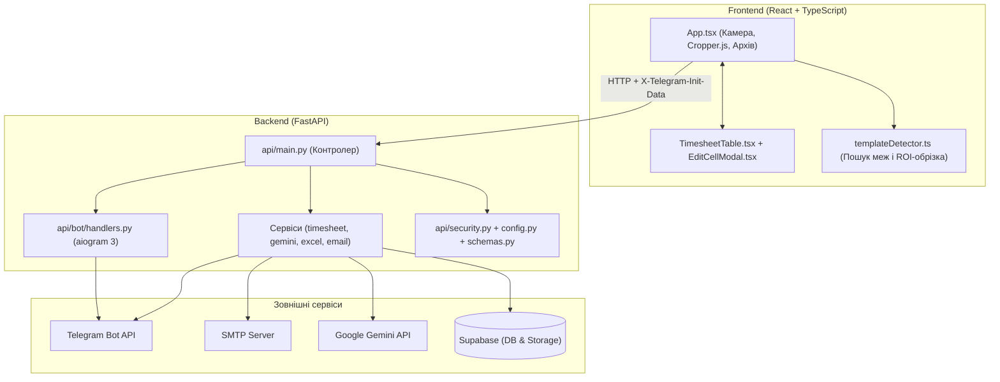
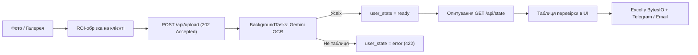

# YSV Helper

Telegram Mini App для оцифрування паперових табелів обліку робочого часу. Застосунок дозволяє сфотографувати заповнений від руки бланк, приховати персональні дані до відправки в хмару, розпізнати таблицю через Gemini, перевірити дані в інтерактивній формі та сформувати `.xlsx` з подальшою відправкою бухгалтеру.

## Суть проєкту

На виробництві табелі обліку робочого часу досі часто заповнюють від руки на паперових бланках форми П-5. Переносити вручну десятки клітинок у підсумкову таблицю довго й незручно.

YSV Helper автоматизує цей процес:
- прибирає ручне перебирання цифр і кодів;
- залишає ПІБ працівників та реквізити підприємства на пристрої користувача під час розпізнавання;
- формує готовий Excel за затвердженим шаблоном і надсилає його в чат Telegram або на email бухгалтерії.

## Як це працює

1. **Захоплення фото.** Користувач робить фото через камеру Mini App або завантажує картинку з галереї через `Cropper.js`.
2. **Локальна обрізка приватних даних (ROI).** Перед відправкою на сервер у браузері виконується обрізка зайвих зон бланка. Доступні режими:
   - `Авто`: пошук меж таблиці на основі 2D інтегрального зображення та проекцій сітки, обрізка по верхній/нижній межах і на 10% зліва від краю таблиці (правий край не обрізається).
   - `Оригінал`: повне зображення без додаткової обрізки.
   - `П-5`: стандартний шаблон (15% зліва, зверху та знизу, 0% справа).
   - `П-5 extended`: розширений шаблон (10% зліва, зверху та знизу, 0% справа).
3. **Фонове розпізнавання.** Запит `POST /api/upload` переводить стан користувача в `processing`, ставить задачу в `BackgroundTasks` та одразу повертає `202 Accepted`. Клієнт опитує `GET /api/state`, поки Gemini (`gemini-4-hydrogen` або резервна `gemini-3.8-flash`) поверне структурований JSON. Якщо на фото не таблиця, сервіс повертає `NotATimesheetError` (`422`).
4. **Перевірка та доставка.** Користувач редагує клітинки в таблиці, за потреби зберігає зміни в архіві (`Supabase`), після чого бекенд заповнює `.xlsx` у пам'яті (`BytesIO` + `openpyxl`) і відправляє файл у Telegram або на email через SMTP.

## Архітектура

Проєкт розділений на клієнтську частину (`React + TypeScript`), тонкий API-контролер (`FastAPI`), сервісний шар і модуль безпеки.

- **Авторизація:** кожен запит з Mini App підписується `X-Telegram-Init-Data`. Бекенд перевіряє підпис `HMAC-SHA256` за допомогою `hmac.compare_digest` і контролює термін дії сесії (`auth_date`).
- **Пісочниця:** якщо `chat_id` користувача не входить до `TRUSTED_USERS` або `ADMIN_ID`, для генерації `.xlsx` використовується знеособлений шаблон, а листи йдуть на технічну адресу замість пошти бухгалтера.
- **Обробка даних:** бекенд повертає сирі UTC-мітки часу з бази, а переведення у локальний час виконується в браузері.



### Потік обробки табеля



## Структура проєкту

```text
.
├── api/
│   ├── bot/
│   │   └── handlers.py            # Обробники Telegram-бота (/start, /broadcast, /msg) і webhook
│   ├── database/
│   │   ├── models.py              # Pydantic-моделі записів БД
│   │   └── session.py             # Ініціалізація клієнта Supabase
│   ├── services/
│   │   ├── email_service.py       # Відправка .xlsx через SMTP з IPv4 fallback
│   │   ├── excel_service.py       # Заповнення .xlsx у пам'яті через openpyxl
│   │   ├── gemini_service.py      # Виклики Gemini API, парсинг JSON та перевірка фото
│   │   ├── template_service.py    # Реєстр профілів бланків на бекенді
│   │   └── timesheet_service.py   # Логіка стану, архіву та фонової обробки
│   ├── config.py                  # Налаштування оточення через pydantic-settings
│   ├── exceptions.py              # Доменні винятки (DomainError, NotATimesheetError тощо)
│   ├── main.py                    # Точка входу FastAPI та маршрути
│   ├── prompts.py                 # Системний промпт та трансформація відповіді ШІ
│   ├── requirements.txt           # Python-залежності
│   ├── schemas.py                 # Pydantic-схеми запитів і відповідей API
│   └── security.py                # Валідація Telegram initData та прав доступу
├── src/
│   ├── components/
│   │   ├── AmbientTrainBg.tsx     # Фонова SVG-анімація та індикатор завантаження
│   │   ├── EditCellModal.tsx      # Модальне вікно редагування клітинки
│   │   └── TimesheetTable.tsx     # Таблиця форми П-5
│   ├── config/
│   │   └── templates.ts           # Координати шаблонів і мапінг кодів неявок
│   ├── types/
│   │   └── timesheet.ts           # TypeScript-типи даних табеля
│   ├── utils/
│   │   └── templateDetector.ts    # Автовизначення меж таблиці та обрізка на canvas
│   ├── App.tsx                    # Екрани застосунку, камера, архів і polling стану
│   ├── index.css                  # Глобальні стилі та Tailwind
│   └── main.tsx                   # Ініціалізація React
├── tests/
│   └── test_app.py                # Автотести безпеки, парсингу, сервісів і маршрутів
├── .env.example                   # Шаблон змінних оточення
├── package.json                   # Frontend-залежності та скрипти
├── pyproject.toml                 # Конфігурація Ruff і Pytest
├── vercel.json                    # Правила маршрутизації для Vercel
└── vite.config.ts                 # Конфігурація Vite
```
